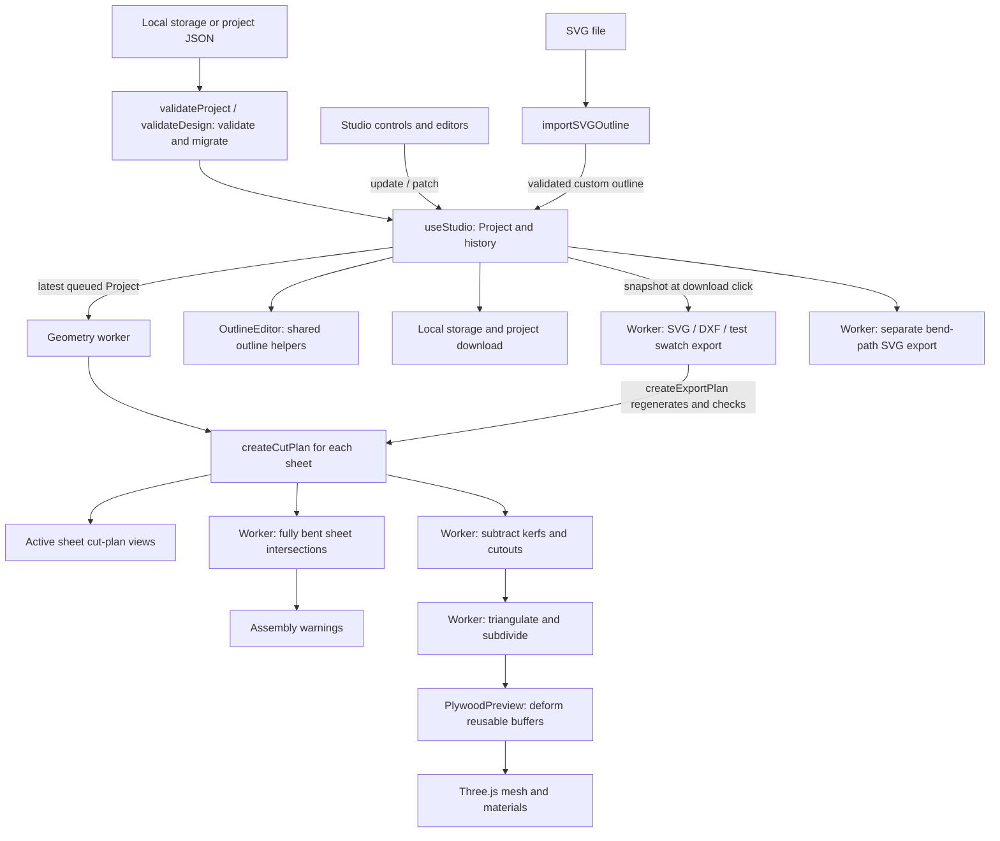

# Architecture

Bentwood is a browser-based studio for designing assemblies of laser-cut bent plywood sheets.
Each sheet has an independent neutral-axis bend path, panel outline, material, and hinge settings.
Projects produce flat cut plans, a shared 3D preview, and manufacturing files. The preview
describes geometry; it does not simulate material strength, springback, or cutting performance.

This document describes the implementation. See the [README](../README.md) for user workflows
and the root [AGENTS.md](../AGENTS.md) for contributor instructions.

## Runtime and data flow

The application is a React 19 and TypeScript SPA built with Vite. It runs entirely in the
browser: there is no backend, account system, database, cloud synchronization, or client-side
router. Cut generation, polygon subtraction, mesh triangulation/subdivision, sheet-intersection
checks, and manufacturing exports run in a module Web Worker. Input validation, detached SVG parsing, mesh deformation,
and GPU rendering remain on the main thread. Browser `localStorage` holds the current project;
project files provide portable backups.

`Project` stores 1–16 `Sheet` entries, each with a `Design` and assembly placement.
`Design` remains the shared input for individual-sheet geometry. `CutPlan` is derived data, not another editable or persisted
model. Laser exports regenerate a plan through the same geometry functions used by the UI;
they do not extract paths from the rendered SVG or Three.js mesh. Bend-path export uses the
fully bent segments directly and is independent of hinge-pattern clearance checks.

## Module map

| Module                                                                                                                                              | Responsibility                                                                                                                                               |
| --------------------------------------------------------------------------------------------------------------------------------------------------- | ------------------------------------------------------------------------------------------------------------------------------------------------------------ |
| [`src/main.tsx`](../src/main.tsx), [`src/App.tsx`](../src/App.tsx)                                                                                  | Mount React in Strict Mode, load global styles, and compose the workspace with state and callbacks from `useStudio`.                                         |
| [`src/hooks/useStudio.tsx`](../src/hooks/useStudio.tsx)                                                                                             | Project state and history, active sheet, sheet lifecycle, placement, derived plans, view state, autosave, imports, and downloads.                            |
| [`src/components/studio/`](../src/components/studio/)                                                                                               | Sidebars, sheet/view navigation, placement controls, canvas switching, dialogs, shared controls, and file inputs. Project imports route through `useStudio`. |
| [`src/components/DesignEditors.tsx`](../src/components/DesignEditors.tsx)                                                                           | SVG bend-path diagram, custom outline editing, and flat cut-plan views, including pointer and keyboard interaction.                                          |
| [`src/components/PlywoodPreview.tsx`](../src/components/PlywoodPreview.tsx)                                                                         | Imperative Three.js scene, mesh deformation, materials, camera controls, and resource lifecycle.                                                             |
| [`src/lib/types.ts`](../src/lib/types.ts)                                                                                                           | `Project`, `Sheet`, `SheetPlacement`, `Design`, `Segment`, `Point`, `PathSample`, `CutLine`, and `CutPlan` contracts.                                        |
| [`src/lib/project.ts`](../src/lib/project.ts)                                                                                                       | Project envelope validation/migration and full-resolution multi-sheet SVG, DXF, and placed bend-path exports.                                                |
| [`src/lib/sheet-intersections.ts`](../src/lib/sheet-intersections.ts)                                                                               | Fully bent sheet-volume intersections, including thickness, nominal cutouts, and placement, with bounded comparison work.                                    |
| [`src/lib/geometry.ts`](../src/lib/geometry.ts)                                                                                                     | Default design and bend presets, path sampling, outlines, cut-plan orchestration, warnings, project validation/migration, and SVG/DXF exports.               |
| [`src/lib/hinge-patterns.ts`](../src/lib/hinge-patterns.ts)                                                                                         | Wavy and zigzag column geometry, clipping, span slicing, and the toolpath-segment budget.                                                                    |
| [`src/lib/honeycomb.ts`](../src/lib/honeycomb.ts), [`src/lib/cutout-lattice.ts`](../src/lib/cutout-lattice.ts)                                      | Parametric Honeycomb cells and clearance; placement, boundary clipping, and nominal removed regions.                                                         |
| [`src/lib/meander.ts`](../src/lib/meander.ts)                                                                                                       | Rounded open slit motifs, repetition, clipping, and clearance checks.                                                                                        |
| [`src/lib/pattern-presets.ts`](../src/lib/pattern-presets.ts)                                                                                       | Named Honeycomb and Meander parameter sets shared by the UI.                                                                                                 |
| [`src/lib/cut-path.ts`](../src/lib/cut-path.ts)                                                                                                     | Canonical cut points, SVG path commands, and toolpath length, including closed-path handling.                                                                |
| [`src/lib/panel-surface.ts`](../src/lib/panel-surface.ts)                                                                                           | Polygon subtraction using `polygon-clipping`; returns surviving contours, holes, and outer/kerf boundaries for the preview.                                  |
| [`src/lib/svg-outline.ts`](../src/lib/svg-outline.ts)                                                                                               | Restricted SVG parsing, curve flattening, normalization, and outline import limits.                                                                          |
| [`src/lib/test-swatches.ts`](../src/lib/test-swatches.ts)                                                                                           | Nine-sample SVG sheets built with the shared export validation and pattern generation.                                                                       |
| [`src/lib/wood-materials.ts`](../src/lib/wood-materials.ts), [`src/lib/wood-texture.ts`](../src/lib/wood-texture.ts)                                | Material identifiers and labels; deterministic procedural grain and appearance settings.                                                                     |
| [`src/components/ui/`](../src/components/ui/), [`src/styles.css`](../src/styles.css), [`src/components/editors.css`](../src/components/editors.css) | Local Radix/shadcn-style primitives, Tailwind integration, workspace styling, responsive panels, and editor styling.                                         |

The asynchronous geometry boundary lives in [`useGeometry.ts`](../src/hooks/useGeometry.ts),
[`geometry-client.ts`](../src/lib/geometry-client.ts), and
[`geometry.worker.ts`](../src/lib/geometry.worker.ts).
[`geometry-jobs.ts`](../src/lib/geometry-jobs.ts) defines messages and cache keys;
[`geometry-processor.ts`](../src/lib/geometry-processor.ts) owns worker-local caches and dispatch.
[`preview-geometry.ts`](../src/lib/preview-geometry.ts) owns flat mesh topology and the pure
buffer-deformation helper. `PlywoodPreview` retains all Three.js resource lifecycle ownership.

## Design state and persistence

`useStudio` stores `{ past, present, future }`, with `present` as the current `Project`.
`updateProject(next)` ignores identical projects, uses `validateProject` (and `validateDesign`
for every sheet) as a guard, and records a new history entry while clearing redo history.
`update` and `patch` apply changes to the active sheet through this project boundary.
Sheet addition, duplication, removal, renaming, placement, and project import share the same history.
History keeps up to 100 past entries during normal updates. Pointer edits group
continuous changes into a single undo step; pointer-up, pointer-cancel, and window blur end
the group.

Camera, unfold amount, active sheet, active view, selected segment, mobile panel, dialogs, and notices
are transient hook state. They are absent from project files and undo snapshots. Swatch
dimensions are memoized; `useGeometry` owns asynchronous assembly snapshots and selects the
active sheet's plan for the 2D views. Removing the active sheet selects a neighboring sheet;
undo may restore a sheet without changing the transient selection.

`SegmentList.tsx` owns pointer/touch and keyboard sorting, committing a reorder only on drop.
`SegmentActions.tsx` shares row actions between the context menu and the visible menu button.
Reordering, removal, type conversion, and direction changes pass through `useStudio` and the
normal validation/history path. `src/lib/segment-editing.ts` preserves segment IDs and neutral-axis
length during conversion, rejecting arcs outside the straight segment’s supported length range.

Numeric text fields commit on blur/Enter; percentage sliders display input immediately and
coalesce design commits per animation frame, flushing before pointer-up closes the undo group.
`useGeometry` lets input paint and coalesces geometry requests for 60 ms. `GeometryClient`
runs one job at a time, retains only the newest queued preview, and prioritizes downloads
between jobs. Superseded queued work is removed immediately; in-flight stale results are
ignored. Existing previews keep their matching design snapshot until a complete replacement
arrives, with an updating indicator. Naming and material changes bypass geometry processing.

The worker caches up to 16 cut plans, up to eight mesh variants with a total buffer budget of
64 MiB, and the latest intersection result. Sheets with identical geometry keys share cached work.
Thickness changes refresh warnings while retaining flat topology. Typed mesh buffers are copied in the
worker and transferred to the UI, preserving the bounded cache. Errors leave editing and the
last complete preview available, with a retry action. Worker cleanup rejects pending requests
and terminates the worker, including under Strict Mode.

The persisted envelope is `Project.version: 5`, containing a project name and 1–16 sheets.
Each sheet has a unique ID, `SheetPlacement`, and `Design.version: 4`. The design stores its
sheet name, straight/arc segments, outline settings, material and thickness, nominal kerf,
pattern family, and continuous pattern parameters. Segment IDs must be unique within a sheet.

`validateProject(unknown)` reconstructs the envelope, strips unknown fields, checks sheet IDs,
count, finite placement bounds, and delegates every sheet to `validateDesign`. Legacy
single-design files are validated and wrapped as a one-sheet project at the origin.

`validateDesign(unknown)` returns a reconstructed current `Design` or `null`. It removes
unknown fields, validates finite numbers and geometry, and migrates older schemas:

- Versions 1 and 2 become Classic; version 1's former edge margin is discarded.
- Version 3's Small waves and Honeycomb become Honeycomb parameter settings; Fine and Wide
  meanders become Meander parameter settings. Dimensional controls are preserved.
- A missing custom-outline corner radius defaults to zero.

Autosave deliberately retains the key **`bentwood.design.v1`** despite project schema version 5, so
existing designs migrate in place. Startup validates stored JSON and falls back to
`createProject(defaultDesign)` when storage is absent, invalid, or unavailable. Each project change attempts
an autosave; failure changes the UI's saved status. History and view state are not persisted.
Opening a project passes the migrated project through `updateProject`, so it participates in undo.
Saving downloads every sheet and placement as a `.bentwood.json` file.

## Coordinates and geometry contracts

| Representation            | Units and meaning                                                                                                                                                                                               |
| ------------------------- | --------------------------------------------------------------------------------------------------------------------------------------------------------------------------------------------------------------- |
| `Segment`                 | Straight lengths and arc radii in millimetres; arc angles in signed degrees. The sign controls bend direction.                                                                                                  |
| `samplePath(segments, s)` | Samples the neutral axis at arc distance `s` in millimetres, returning bent-path `x`, `y`, and a tangent angle in radians. The path starts at the origin along positive X.                                      |
| Flat sheet / `CutPlan`    | `x` is distance along the unrolled path; `y` runs across panel width and increases upward. All coordinates are millimetres.                                                                                     |
| `Design.customOutline`    | Editable polygon vertices normalized to `[0, 1]` in both axes. `getOutline` scales them by path length and effective width before rounding corners.                                                             |
| Three.js mesh             | Flat `x` maps through the bent path into world X/Z; flat `y` maps to world Y. Thickness offsets either side of the neutral axis along its normal.                                                               |
| `SheetPlacement`          | X/Z translate along the floor; Y translates vertically. Rotation is signed degrees around positive Y, about the neutral-axis path start. A positive 90° rotation points the starting tangent toward negative Z. |
| Panel SVG / DXF           | Panel SVG converts model Y-up coordinates to screen Y-down. DXF retains Y-up coordinates. Both manufacturing formats use millimetres at 1:1 scale.                                                              |

The separate bend-path SVG follows the bend-path editor orientation without the panel Y flip.
Arc length is `radius × abs(angle in radians)`. Segments meet tangentially. Square and circle
widths come from path length via `getPanelWidth`, rather than the stored `design.width`.

Built-in circles and ellipses have 128 outline vertices for preview tessellation, while
their exterior exports and cut-boundary intersections use analytic curves. Custom corner
rounding leaves the editable normalized vertices intact and creates a physical polyline
with a maximum chord error of 0.01 mm, shared by previews and exports. Concave simple outlines
are supported; user-defined holes, self-intersections, and degenerate polygons are not.

### Cut generation

`createCutPlan` calculates sheet dimensions and outline, checks geometric conditions, then
generates cuts in curved sections of the bend path. Straight sections remain uncut.

- Classic and Graded use straight staggered columns. Graded scales spacing by bend radius,
  capped at twice the requested spacing. Column clearance and bridge phase carry across arc
  boundaries.
- Wavy slits and Zigzag create shaped columns, clip them to the outline, and slice them into
  staggered cut spans. Shape-aware clearance accounts for slope and amplitude.
- Honeycomb places staggered closed openings, clips boundary cells, and retains nominal
  removed regions separately from the laser paths.
- Meander places rounded open slits with overlapping ends. Its `bridge` field means end
  separation; repeat distance and clearance also depend on `meanderOverlap`.

Narrow boundary regions may remain uncut to preserve connecting material. A boundary
Honeycomb opening has an open laser contour and a filled removed region: closing that
toolpath along the panel edge would duplicate an exterior cut.

`CutLine` represents a straight cut compactly with `x`, `y1`, and `y2`, or a shaped cut with
`points`. `closed` controls the closing edge; `roundCaps` supports the laser footprint at
Meander tips. Consumers use `getCutPoints`, `cutPathData`, and `cutPathLength` so all formats
agree about points and closure. `CutPlan.cutouts` describes removed areas, not additional
laser toolpaths. `Design.cutLength` is a pattern dimension; `CutPlan.cutLength` estimates
total exterior-plus-hinge travel.

### Validation, warnings, and limits

There are distinct checks at different boundaries:

1. `validateProject` validates the envelope and placement; `validateDesign` validates each sheet
   and bounds estimated resource use before accepting a stored, imported, or edited project.
2. `createCutPlan` produces warnings and enforces generation limits, including actual output
   counts that can exceed estimates on complex outlines.
3. `createExportPlan` rejects invalid outlines, excessive pattern complexity, and kerf that
   consumes required connecting material. SVG, DXF, and each test swatch use this gate. Combined
   laser exports must pass it for every included sheet.
4. `findSheetIntersections` checks fully bent assembly volumes in the worker. Intersection
   warnings are advisory and do not block exports.

Tight bends, path crossings, and skipped narrow spans are advisory warnings, not all export
blockers. Passing validation does not establish manufacturability. `createExportPlan` and
parts of plan generation inspect warning substrings such as `laser kerf`, `50,000`, and
`250,000`; wording changes can therefore affect behavior.

| Boundary                | Current limit                                                                                                                                                                                                                      |
| ----------------------- | ---------------------------------------------------------------------------------------------------------------------------------------------------------------------------------------------------------------------------------- |
| Project JSON upload     | 1,000,000 bytes in `useStudio.tsx`.                                                                                                                                                                                                |
| Project sheets          | 1–16, with unique nonempty IDs of at most 100 characters.                                                                                                                                                                          |
| Sheet placement         | X/Y/Z each within ±10,000 mm; rotation within ±360°.                                                                                                                                                                               |
| SVG upload              | 1,048,576 bytes; checked before parsing.                                                                                                                                                                                           |
| Bend path               | 1–50 segments and at most 10,000 mm total length.                                                                                                                                                                                  |
| Editable custom outline | 3–128 normalized vertices forming a simple polygon.                                                                                                                                                                                |
| Pattern generation      | At most 50,000 cuts and 250,000 toolpath segments per sheet; estimates and generation-time guards bound work.                                                                                                                      |
| Detailed preview kerfs  | At most 2,500 cuts and 20,000 segments; larger plans use surface centre lines.                                                                                                                                                     |
| Intersection checks     | At most 100,000 prisms and 250,000 tree/prism comparisons per assembly; incomplete checks produce a warning. Nominal cutouts are subtracted up to 2,500 rings / 20,000 vertices, otherwise solid outlines are used with a warning. |
| SVG parsing             | At most 5,000 elements, nesting depth 64, 4,096 curves, and 8,192 flattening samples before the 128-point editor limit.                                                                                                            |

Exact numeric field ranges live in `validateDesign` and `validateProject`. These limits bound CPU and memory use
in both the main thread and worker. The preview's lower detail budget never reduces exported
toolpaths.

Intersection checks reject separated sheets using conservative path/outline bounds before
building triangular prisms from fully bent, subdivided surfaces. They then use bounding-volume
trees and tetrahedron separating-axis tests. They include thickness,
outline shape, nominal cutout openings, and placement; touching is reported as an intersection.
Laser kerf slits are deliberately ignored as assembly clearance. The check uses the preview's
tessellation (maximum longitudinal step `max(1, sheetLength / 280)` mm), so it is approximate.
It remains independent of the preview's unfold slider and cut-visibility switch.

## 3D preview lifecycle

`PlywoodPreview` owns a Three.js renderer and scene through refs and effects. It renders on
demand after model, camera, control, or size changes. It cleans up controls, listeners,
observers, geometries, materials, textures, and the renderer when replaced or unmounted;
the lifecycle must tolerate React Strict Mode.

Each sheet has its own panel group and wood materials in the shared scene. Sheet groups retain
their assembly placements; camera fitting uses the bounds of the whole assembly. Changing
the active sheet affects editors and controls without removing the other sheets from the preview.

`createPreviewGeometry` runs `createPanelSurface` in the worker to subtract nominal cutouts
and kerf footprints from the flat outline before triangulation and subdivision. The surviving contours and holes form the two panel faces; classified
boundaries form layered exterior walls and dark kerf walls. This keeps edge-reaching cuts
open through the panel's thickness. Polygon subtraction retries with narrowly scoped
coordinate snapping when coincident boundaries cause numerical trouble.

Unfolding scales arc angles by the bend fraction and inversely scales radii, preserving
neutral-axis length. At zero bend, arcs become straight segments of the same length. UVs
come from flat sheet coordinates, keeping procedural grain attached to the material.

Flat topology is cached in the worker independently of material, thickness, and unfold amount.
The preview reuses GPU buffers and materials while unfolding, updates positions/normals in place,
and coalesces rendering into animation frames. Prepared path samplers precompute segment poses
and use binary search; each deformation shares samples and normals across equal sheet X values.
Grain canvases are cached by material. When detailed cuts exceed the preview budget, all cuts are shown as centre lines. Honeycomb
voids can still be subtracted if their separate cutout budget permits. The UI labels the
simplification. A WebGL initialization failure shows a fallback message while 2D editing
and exports remain available.

## Import and export boundaries

SVG import dynamically loads `svg-outline.ts` and Three.js's `SVGLoader`. It parses the file
in a detached XML document, builds a restricted clean SVG from supported geometry attributes,
and passes that to the loader. Uploaded markup is not inserted into the live page. Document
types/entities are rejected; scripts are ignored; unsupported geometry-changing effects,
multiple closed outlines, and holes are rejected. An active-sheet Bentwood export's
`outer-contour` is selected so its hinge paths are not imported as additional outlines.
An all-sheet export still has multiple outer contours and is rejected as an outline import;
project JSON restores a complete assembly.

Curves are flattened into editable points. Import scales the outline to the current unrolled
length, updates panel width to preserve proportions, flips Y into model coordinates, and
resets corner radius to zero. It does not retain the SVG's original physical dimensions.
`useStudio` checks request identity, project identity, and active sheet identity before applying
an asynchronous import, preventing stale results from overwriting newer imports, intervening
edits, or another sheet. Project-file import similarly guards against intervening edits and sheet switches.

| Download          | Contract                                                                                                                                                                                                            |
| ----------------- | ------------------------------------------------------------------------------------------------------------------------------------------------------------------------------------------------------------------- |
| Panel SVG         | Physical `mm` dimensions and matching `viewBox`; red `outer-contour` and blue `hinge-cuts` groups. Circle/ellipse exteriors use arc commands.                                                                       |
| Panel DXF         | Millimetre insertion units; `OUTER_CONTOUR` and `HINGE_CUTS` layers. Circle/ellipse exteriors use `CIRCLE` / `ELLIPSE` entities.                                                                                    |
| Bend-path SVG     | One unfilled grey neutral-axis path with exact lines/arcs, fully bent regardless of the unfold slider. A 1 mm canvas margin does not alter dimensions. No thickness, cutter, or fit offset.                         |
| Test swatches SVG | Nine samples varying spacing and bridge/end separation around current settings, with fixed family shape parameters. Every sample must pass export validation. Labels live in the separate `engraving-labels` group. |
| Project JSON      | Version 5 `Project` containing every sheet and placement, serialized as `.bentwood.json`; reload through `validateProject` / `validateDesign`.                                                                      |

The export dialog selects the active sheet or whole project. All-sheet laser exports place
flat sheets side by side with 10 mm gaps, ignoring assembly placement. The dialog renders all
included cut plans for whole-project exports. [`sheet-layout.ts`](../src/lib/sheet-layout.ts)
shares the sheet offsets and total dimensions between that preview and SVG/DXF exports. SVG retains the
canonical groups with unique per-sheet subgroup IDs; DXF retains its canonical layers and
translates entity points without altering ellipse axis vectors. Names, materials, thicknesses,
and kerfs are recorded as non-cutting metadata. No labels or extra closing cuts are introduced.
All-sheet bend-path SVGs retain X/Z placement and rotation with one exact path per sheet;
vertical Y is omitted. Active-sheet bend paths retain local coordinates. Test swatches remain
specific to the active sheet.

Laser exports contain tool centre lines with **no kerf compensation**. Nominal kerf affects
checks and the rendered removed material, not offsets in the exported toolpaths. Preview
appearance and unfolding never change manufacturing dimensions. Downloads snapshot the selected design or project
and filename at the click, then generate files in the worker
independently of a pending preview. Duplicate clicks are disabled during generation. Downloads
use Blob URLs that are revoked after the browser starts the download.

## Build, deployment, and verification

Node 24 is pinned in `.nvmrc` and `package.json`; npm uses the checked-in lockfile. TypeScript
runs in strict mode with unused-local and unused-parameter checks. `@/` resolves to `src/`
in both TypeScript and Vite. Vite enables React and Tailwind, separates Three.js into a manual
chunk, and prebundles the lazy SVG loader to avoid a dev-server reload during the first import.

`npm run build` typechecks and writes the static site to `dist/`. `vercel.json` installs with
`npm ci`, runs that build, and serves `dist/` with security headers, immutable hashed-asset
caching, and revalidated entry HTML. There is no catch-all rewrite. No application API keys
or runtime environment variables are required. Files in `public/`, including the committed
social image, are copied into the build. `scripts/generate-og-image.mjs` regenerates that image
using the app and Playwright; production builds do not run it.

Vitest tests beside `src/lib` verify geometry, migration, clipping, exports, swatches, and
procedural textures. Playwright specs in `tests/` cover real browser workflows, persistence,
file downloads/imports, preview behavior, keyboard interaction, mobile panels, and axe
accessibility checks. The browser suite runs Chromium with one worker against
`http://127.0.0.1:5174`; its config starts Vite with a strict port and reuses an existing server
outside CI. See [AGENTS.md](../AGENTS.md) for focused verification commands.
